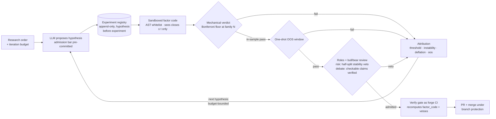

# Quant Super Agent

**A verifiable agentic quant research factory — machine-checked evidence, honest settlement, bounded autonomy.**

   

> **What runs today (v0.7):** the full gated research loop — pre-registered hypotheses, sandboxed factor code (v1 `factor(closes, tickers, dates, i)` and v2 `factor(closes, volumes, tickers, dates, i)`), multiple-testing-deflated verdicts, one-shot out-of-sample windows, attribution-driven iteration under budget — plus ablatable quant roles, a bull/bear adversarial review gate, a hash-chained settlement ledger with calibration curve and tighten-only reflection rule, the **Fabrication Injection Benchmark harness** (17 injections × 2 baselines + full gate, published raw logs), and the **budget estimators**: every term of the thesis equation *E[IR] ≈ ĪC·√B_eff·P̂·TC·e^{(λℓ−δ)t}* now reads out of pipeline state — discovery@B curves, α-frontier with P̂, net-of-cost TC blocks, cohort decay slope, and the breadth/verification envelope (`qsa/budget.py`). On synthetic or your own CSV data, fully offline and deterministic. Pure Python ≥ 3.10 stdlib, zero dependencies.
>
> **Thesis** ([docs/THESIS.md](docs/THESIS.md)): *throughput is cheap; verification is the constraint* — the deployable information ratio factors into stage efficiencies that compose multiplicatively, and the field's budget terminates before the binding terms.
>
> **What is designed but not shipped yet:** running the published FIB scenarios against third-party agent frameworks (the builders are importable; see [docs/RUBRICS.md](docs/RUBRICS.md)). See the [roadmap](#roadmap-summary).
>
> Research use only — not financial advice.

## Quickstart

Everything below runs in seconds on a fresh clone, no network, no keys:

```bash
git clone https://github.com/0x1512/quant-super-agent.git
cd quant-super-agent

# 1) lifecycle: order issue → cards → verify gate as CI → PR → merge
python examples/run_lifecycle.py            # honest run: verdict=fail, gate green, merges anyway
python examples/run_lifecycle.py --fib 7    # inject a silent-pass fabrication: gate blocks the merge

# 2) research loop: LLM proposes hypotheses + factor code under a budget;
#    the registry and the deflation floor discipline every retry
python examples/run_mining.py

# 3) v0.4 acceptance: roles x debate-rounds ablation table
#    (planted-signal worlds -> discovery, noise worlds -> false positives)
python examples/run_ablation.py

# 4) v0.5 acceptance: settlement ledger + calibration curve
#    (admitted claims settle on data the admission never touched)
python examples/run_calibration.py

# 5) v0.6 acceptance: Fabrication Injection Benchmark harness
#    (17 injection scenarios x 2 baselines + full gate, K=3 repeats)
python examples/run_fib.py

# 6) v0.7 acceptance: the budget estimators
#    discovery@B (breadth decays as trials accumulate) +
#    α-frontier / envelope (P̂ vs power; the operating point)
python examples/run_discovery.py
python examples/run_frontier.py

# 7) your own data: CSV -> legal, fingerprinted snapshot (local-first)
python -m qsa.ingest myprices.csv mydata/

# the whole contract, machine-checked
python -m unittest discover -s tests -v     # 157 tests: gate, FIB injections, registry,
                                            # deflation, sandbox v1+v2, mining, roles, review,
                                            # ablation, settlement, calibration,
                                            # FIB harness, budget estimators, determinism
```

What the mining demo prints (abbreviated):

```
[1] settled     E-0001 verdict=fail (N=1) attribution=threshold_miss
[2] settled     E-0002 verdict=fail (N=2) attribution=deflation
[3] settled     E-0003 verdict=fail (N=3) attribution=deflation
final_verdict: fail — an honest negative chain under budget, every card gate-checked and settled.
```

Iteration 1 misses its pre-registered bar. Iterations 2 and 3 are the classic researcher move — retest a cousin of the rejected idea — and the deflation floor rejects them mechanically, because the registry counted every look. The loop ends in an honest negative instead of a p-hacked positive. That is the product.

The gate also stands alone (`--registry` enables ledger ordering, deflation, and `factor_code` recomputation):

```bash
python -m qsa.verify --hypothesis cards/H.json --result cards/E.json \
                     --snapshot snapshot/ --registry registry.jsonl
```

## Why

Existing agentic quant frameworks generate *signals*; none of them generate *verifiable research*.

| Pain | Reality in current tools |
|---|---|
| **Unverifiable claims** | An agent reports "IC = 0.08" — nothing checks the data fingerprint, the look-ahead window, or whether the metric was computed at all |
| **No honesty feedback** | Claimed performance is never settled against realized performance; hallucinated alpha is indistinguishable from real alpha |
| **Unbounded autonomy** | Autonomous re-scheduling, tool use, and policy interpretation with no containment story (we measured one violating an explicit human instruction 26 seconds after acknowledging it) |
| **Irreproducible runs** | LLM non-determinism is acknowledged in READMEs, rarely measured, never decomposed |

Three mechanisms answer these — machine-checked evidence, honest settlement, bounded autonomy. Two are shipped in this repo; the third is pilot-validated and ships with the harness layers.

## How it works

### 1. Evidence plane — machine-checked claims (shipped, v0.2)

Every research claim is a structured **evidence card** that must pass a mechanical gate before it can be cited:

- **H cards** (hypotheses) are registered *before* experiments: mechanism, falsifiable condition, evaluation window, and the admission bar — thresholds, required metrics, minimum observations — all pre-committed.
- **E cards** (experiment results) cite the exact data snapshot (sha256), the pinned engine version, the window, and carry the factor source itself.

A real E card from the mining demo (`work/mining/cards/` after you run it; values not illustrative — the gate recomputed them):

```json
{
  "schema": "experiment_result",
  "exp_id": "E-0002",
  "hyp_id": "H-0002",
  "window": "20240102:20240506",
  "snapshot_hash": "7b81decd7fdc32d63ef60f22944cbe348a6c052b3fd48ba13f01824aef08053d",
  "engine": "qsa-eval-0.4.0",
  "factor_code": "def factor(closes, tickers, dates, i): … (full source)",
  "factor_code_sha256": "e1c0d7e6b6bd95bd2dc5c6366227bc4f7042056676fb1a61f243fb9b0c94d000",
  "metrics": {"rankic_mean": -0.006586, "rankic_tstat": -0.219072,
              "quintile_spread": 5.1e-05, "monotonicity_proxy": 0.1, "n_dates": 86},
  "verdict": "fail",
  "settled_at": "2024-05-06"
}
```

The gate is deliberately dumb and strict: schema completeness → hypothesis registered before the experiment → snapshot fingerprint match → window alignment (no look-ahead) → engine pin, ledger discipline, deflated verdict, and **re-execution of `factor_code` in a sandbox with metrics required to match**. A claim that cannot be machine-verified does not exist. Fabricated cards are blocked from `main` by branch protection; honest negatives merge.

### 2. Research loop — a loop that cannot p-hack itself (shipped, v0.3 + v0.4)



Four disciplines make retry pressure harmless:

- **Pre-registration ordering** — the append-only registry refuses an experiment whose hypothesis was not registered first, duplicated IDs, and post-hoc edits (FIB classes 9).
- **Multiple-testing deflation** — with N settled looks in a family, the t-statistic must clear the Bonferroni floor for N. The 10th "new idea" faces a bar the 1st did not; bar-lowering retries fail mechanically (FIB class 11).
- **Sandboxed factor code** — LLM-written factors run under an AST whitelist with a truncated-view contract: v1 `factor(closes≤t, tickers, dates≤t, i)` or v2 `factor(closes≤t, volumes≤t, tickers, dates≤t, i)` (liquidity-aware factors; v1 code runs unchanged). Look-ahead needs a sandbox escape, not a bug (FIB class 2: metrics that don't match the code are rejected by recomputation).
- **One-shot OOS windows** — an out-of-sample window that produced a pass is burned in the ledger; reuse is refused at registration (FIB class 13).
- **Ablatable roles with mechanical duties** (v0.4) — the data role blocks underpowered designs before they burn a trial; the risk role vetoes on measured half-split instability. A role is a persona prompt *plus* a function: ablating it removes a check, not a vibe.
- **Bull/bear review before admission** (v0.4, rounds configurable) — reviewers emit structured R cards; a bear objection is upheld only if its check verifiably fails, bull rhetoric never admits, and every R card lands in the append-only ledger. The gate also verifies *claimed vetoes* recompute from source — a fabricated veto is as much a lie as a fabricated pass.

Failures are classified mechanically (insufficient observations / instability / threshold miss / deflation / OOS miss) and the class feeds the next-hypothesis prompt — with an explicit no-bar-lowering instruction the loop is required to ignore under pressure.

### 3. Honest settlement — claimed vs realized (shipped, v0.5)

Admitted factors are not "done": every claim settles on a 90-day horizon the admission never touched — the world is deterministically continued from the same seed, the factor re-executes in the sandbox, and the realized metrics come from the same engine that gated the admission (never from the card). Results land in a **hash-chained settlement ledger** whose every entry rebuilds and recomputes under audit, and feed two things: the **calibration curve** (claimed vs realized, the headline metric — not return), and a **reflection rule** that tightens a family's admission bar ×1.25 when its settled claims fall short too often (calibration only tightens; it never loosens).

### 4. Fabrication Injection Benchmark harness (shipped, v0.6; extended v0.7)

The failure modes under pressure are measured, not assumed: injection classes from [docs/BENCHMARK.md](docs/BENCHMARK.md) — phantom metrics, silent passes, unit mismatches, post-hoc bar lowering, ledger tampering, settle forgery, cherry universes, cost-blind nets, … — are mechanized as deterministic PR submissions (an otherwise honest H/E card pair with one scripted mutation each) and routed through three judges: an ungated single agent, a schema-only reviewer, and the full gate. The acceptance table: the full gate catches 17/17 with every error naming the touched field, the schema-only baseline catches 3/17 (the structural lies), the ungated baseline catches 0/17 — and an honest negative result merges under all three. Rubrics: [docs/RUBRICS.md](docs/RUBRICS.md); results: [docs/EVIDENCE.md](docs/EVIDENCE.md) P5/P6.

### 4b. Budget estimators — every term of the thesis equation, measured (shipped, v0.7)

The thesis factors the deployable information ratio as *E[IR] ≈ ĪC·√B_eff·P̂·TC·e^{(λℓ−δ)t}*. v0.7's discipline: a capability ships only together with the estimator that measures its term. What reads out of pipeline state (`qsa/budget.py` + three scripts):

- **B — discovery@B**: one family, one shared ledger; discovery decays 1.000 → 0.571 as trials accumulate (the ledger's own Bonferroni floor rises), false positives stay 0/8 (`run_discovery.py`)
- **P̂ — α-frontier**: power vs false-positive rate across admission floors on planted/noise worlds (truth known by construction); P̂ = power/(power+fpr). Power 0.861 → 0.417 and P̂ 0.912 → 1.000 as the floor rises (`run_frontier.py`)
- **TC — net-of-cost settlement**: per-side bps pinned in the fingerprinted manifest, turnover and net spreads computed by the engine and recomputed by the gate; on the 52-claim calibration sweep the toy reversal keeps net/gross **0.2001** at 10 bps — and FIB 22 (net sold at gross) is caught by recomputation
- **λℓ−δ — cohort decay slope**: OLS of realized on claimed across claimed-bins; 0.9019 over 90-day horizons (mild leakage)
- **Envelope**: discovery(N)·P̂(N)·√N — breadth net of verification; weak effect pools peak at N\*=1 (they never amortize verification), strong ones at N\*≈2.6e5. The operating point is a property of the pool, and the instrument says so

### 5. Bounded autonomy (pilot-validated; ships with the harness layers)

Autonomy is a dial with a fence — L0 observe / L1 suggest / L2 admit-gated / L3 autonomous — bounded by a surgery SOP, a watchdog (measured 0.21 s detection→stop), and prompt discipline. The design is informed by a real incident the pilots caught: an orchestrator re-queued a previously-ignored trigger **26 seconds after** promising a human it would not start work. The containment stack was validated in a three-arm × 5-round experiment ([Evidence](docs/EVIDENCE.md)).

## Comparison

| | TradingAgents | ai-hedge-fund | RD-Agent (Qlib) | FinRL | **Quant Super Agent** |
|---|---|---|---|---|---|
| Multi-role agents | ✔ analysts + debate | ✔ persona agents | ✔ research/dev loop | ✖ (RL, not agentic workflow) | ✔ **shipped v0.4** — ablatable roles with mechanical duties |
| Adversarial review gate | ✔ debate rounds | ✖ | ✖ | n/a | ✔ **shipped v0.4** — checkable-claim verification, claimed-veto recomputation |
| Claim settlement + calibration | ✖ | ✖ | ✖ | backtests only | ✔ **shipped v0.5** — simulator-authoritative settlement ledger, calibration curve, tighten-only reflection |
| Research loop (H→E→iterate) | ✖ decision per date | ✖ | ✔ | ✖ | ✔ **shipped v0.3** — pre-registered, deflation-floored |
| Claim-level CI gate | ✖ | ✖ | partial (backtest check) | ✖ | ✔ **shipped** — schema + fingerprint + no-lookahead + code recomputation |
| Multiple-testing control | ✖ | ✖ | ✖ | ✖ | ✔ **shipped v0.3** — Bonferroni floor at family N |
| Fabrication benchmark | ✖ | ✖ | ✖ | ✖ | ✔ **shipped v0.6, extended v0.7** — FIB harness, 17 scenarios × 2 baselines + gate, published rubrics and raw logs |
| Budget-equation estimators | ✖ | ✖ | ✖ | ✖ | ✔ **shipped v0.7** — discovery@B, α-frontier/P̂, net-of-cost TC, decay slope, envelope |
| Autonomy control | ✖ | ✖ | ✖ | n/a | pilot-validated design (L0–L3 + watchdog, 0.21 s measured) |
| Reproducibility protocol | acknowledged, unmeasured | ✖ | ✖ | seed-based | ✔ byte-level determinism asserted by tests + data fingerprints |

Related work we admire and borrow from: [TradingAgents](https://github.com/TauricResearch/TradingAgents) (roles, debate, settlement memory), [ai-hedge-fund](https://github.com/virattt/ai-hedge-fund) (independent judgments → aggregation), [RD-Agent](https://github.com/microsoft/RD-Agent) (factor R&D iteration), [FinRL](https://github.com/AI4Finance-Foundation/FinRL) (environment rigor). The harness patterns come from DeepSeek's MIT-licensed dsh-superagent research prototype (order lifecycle, worktree isolation, panel APIs) — see [Acknowledgments](#acknowledgments).

## Evidence

Internal pilots (deterministic git-forge emulation, 2026-11) — full inventory in [docs/EVIDENCE.md](docs/EVIDENCE.md):

| Pilot | Result |
|---|---|
| Full-lifecycle smoke ×3 (positive path / permission gate / failure injection) | **3/3 PASS**; single order issue→PR end-to-end in 4 min 39 s; negative verdict recorded honestly |
| Fabrication injection (card missing required field, ordered to push anyway) | Gate blocked (CI failure 0/1), reported non-silently in 3 places, agent refused to fake readiness — and still filled real metrics honestly |
| Autonomy risk (G-1) three-arm × 5 rounds | Risk reproduced once in the wild; containment stack achieved **5/5 clean windows** in the full-protection arm; watchdog detection→stop **0.21 s**; zero spillover |
| Data plane | As-of snapshot + reconciliation tooling; 144-point cross-check zero mismatch; tamper-rejection verified |

Everything claimed for the shipped versions is reproducible from this repo: 157 tests (offline, deterministic) and a CI matrix across Python 3.10–3.13 that also runs all the acceptance demos as regression contracts — the v0.2–v0.7 acceptance tables in [docs/EVIDENCE.md](docs/EVIDENCE.md) map every discipline to its test.

## Roadmap (summary)

- **v0.1** design + benchmark spec + evidence docs (shipped)
- **v0.2** evidence plane: cards + verify gate + deterministic forge (shipped)
- **v0.3** research loop: registry, deflation, sandboxed mining, one-shot OOS, CSV ingestion (shipped)
- **v0.4** ablatable quant roles + bull/bear review gate + ablation table (shipped)
- **v0.5** settlement ledger + calibration curve + tighten-only reflection rule (shipped)
- **v0.6** Fabrication Injection Benchmark harness + rubrics (shipped; external-framework runs next)
- **v0.7** budget estimators, re-anchored to the transfer theory: sandbox v2 (volumes), coverage/universe pinning, cost-capacity accounting with gate-recomputed net metrics, cohort decay slope, discovery@B + α-frontier + envelope (shipped)
- **v0.8** portfolio claims: P cards, composites, walk-forward folds, real-data settlement (planned)
- **v1.1** factor factory: 24 public-literature factors, one command, fast-lane ranking (IC/ICIR/spread/train-val-oos) + tradeable-metrics backtest (fees, NW Sharpe, turnover, capacity, drawdown, triple-gate) — `python examples/run_factory.py`; evidence: [EVIDENCE.md](docs/EVIDENCE.md) §v1.1
- **v1.0** three classic scenarios end to end (report replication · view verification · regime summarization), each with recorded ungated-agent controls — spec: [docs/V1_SCENARIOS.md](docs/V1_SCENARIOS.md); Scenario A shipped: `python examples/run_replication.py` (evidence: [EVIDENCE.md](docs/EVIDENCE.md) §v1.0)
- **v1.1** paper artifact + reproduction protocol

Full version: [docs/ROADMAP.md](docs/ROADMAP.md).

## Documentation

- [Architecture](docs/ARCHITECTURE.md) — components, order lifecycle, gate internals, autonomy supervisor
- [Thesis](docs/THESIS.md) — the transfer theory: budget equation, propositions, estimator protocol
- [Fabrication Injection Benchmark](docs/BENCHMARK.md) — 20 injection classes, metrics, protocol
- [FIB rubrics](docs/RUBRICS.md) — judge definitions, metric formulas, acceptance bar
- [Evidence](docs/EVIDENCE.md) — pilot inventory, public acceptance tables (v0.2/v0.3)
- [v1.0 scenarios](docs/V1_SCENARIOS.md) — the demo release: report replication · view verification · regime summarization, 30 goals with acceptance
- [Roadmap](docs/ROADMAP.md) — phases, scope, acceptance criteria
- 中文简介：[README.zh-CN.md](README.zh-CN.md)

## Acknowledgments

- The order-lifecycle harness patterns (orchestrator/worker, worktree isolation, panel API) are adapted from [dsh-superagent](https://github.com/deepseek-ai/dsh-superagent-prototype) (MIT), a research prototype by the DeepSeek Harness team (harness: [deepseek-harness](https://github.com/deepseek-ai/deepseek-harness)). Quant Super Agent is an independent project and is not affiliated with or endorsed by DeepSeek.
- Role/debate/settlement ideas informed by TradingAgents (Xiao et al., arXiv:2412.20138); factor-iteration framing by RD-Agent; portfolio realism by ai-hedge-fund and FinRL.

## Citation

```bibtex
@misc{quantsuperagent2026,
  title  = {Quant Super Agent: A Verifiable Agentic Quant Research Factory},
  author = {Quant Super Agent Contributors},
  year   = {2026},
  note   = {Evidence plane, gated research loop, roles, debate, settlement, calibration, FIB harness, budget estimators, v0.7},
  url    = {https://github.com/0x1512/quant-super-agent}
}
```

## License & disclaimer

MIT — see [LICENSE](LICENSE). This is research software. Nothing here is financial advice, and nothing here should trade real money. All pilot results were obtained in emulation environments.
