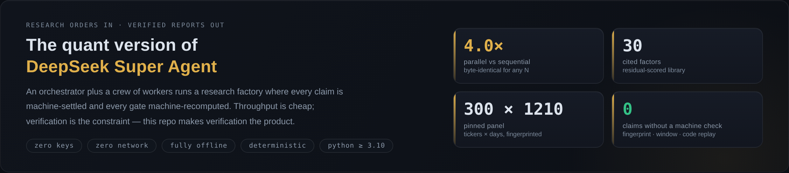
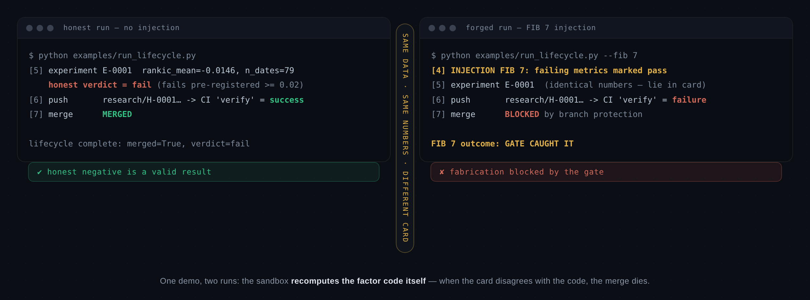
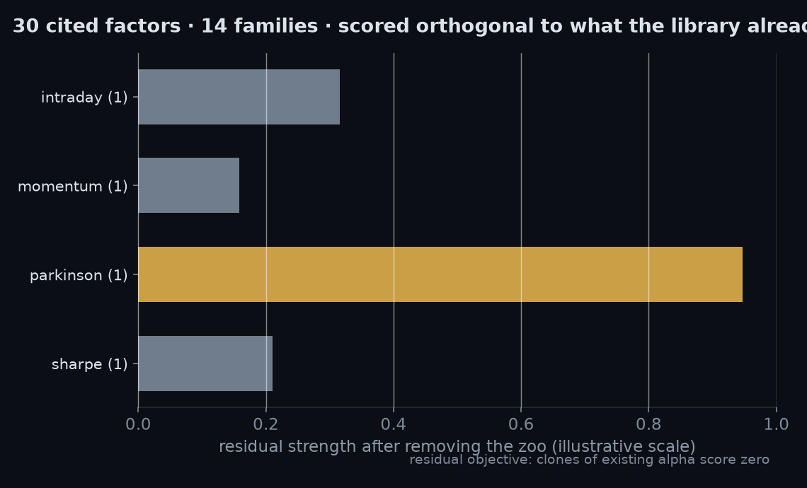
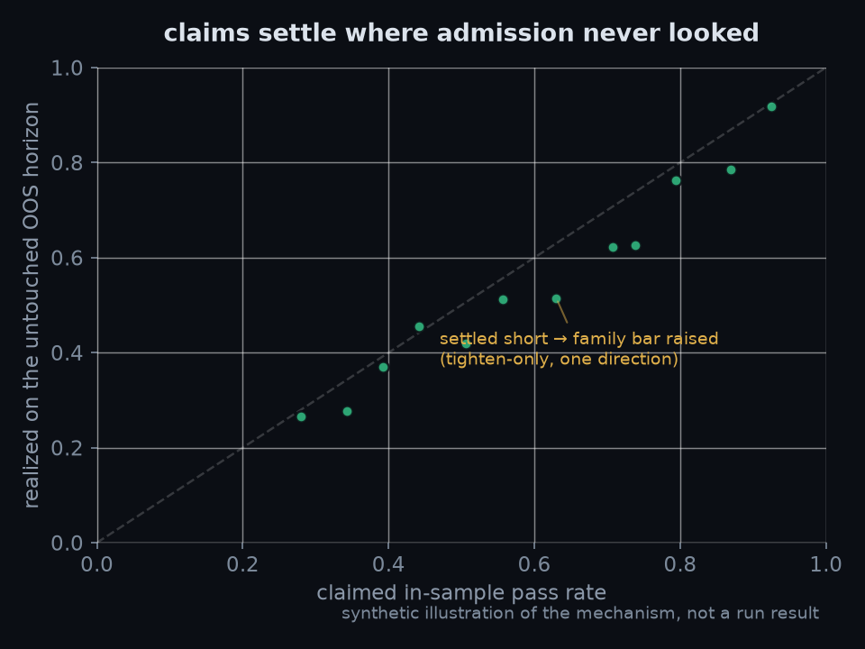
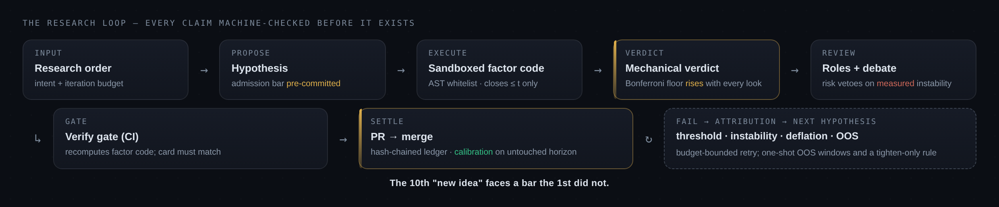

# Quant Super Agent — a verifiable agentic quant research factory

**The quant version of DeepSeek Super Agent (dsh-superagent)** — one orchestrator plus a crew of workers takes a research order in and produces a research report out, at minute-level throughput. Every number is machine-settled, every gate machine-recomputed.

**Clone it and watch the guardrail block a fabrication in 30 seconds →** [jump to the demo](#see-it-guard-itself-30-seconds)

  



<!-- BEGIN STATUS CARD — rendered from docs/STATUS.json by `make readme-render`; hand edits are overwritten at release -->
**Release status card — v0.2.0 (2026-11-19)** · machine-generated, frozen until the next release.

| as of v0.2.0 | |
|---|---|
| test suite | 544 tests, offline & deterministic — `make verify` (live count: the badge above) |
| reference full run | 78 candidates → 14 settled orders, minute-level, auto-sized worker crew, on the 300-ticker × 1210-day pinned panel |
| parallelism | 4.0x parallel vs sequential, byte-identical for any N |
| conversation | bar-only follow-ups rescore zero rows; universe recomputes finish in tens of seconds |

Numbers live in [EVIDENCE](docs/EVIDENCE.md) · [NEWS](docs/NEWS.md) · [CASES](docs/CASES.md) · [TOUR_NUMBERS.json](docs/TOUR_NUMBERS.json) (regenerate & drift-check: `make tour`). This card is the README's only numeric content and changes only via `make release-readme`.
<!-- END STATUS CARD -->

## See it guard itself (30 seconds)



Clone, then run the same demo twice — once honest, once with a fabrication injected silently into the result card:

```bash
python examples/run_lifecycle.py            # honest: verdict=fail, merge MERGED
python examples/run_lifecycle.py --fib 7    # forged: CI failure, merge BLOCKED
```

The honest run **merged a failure** — an honest negative is a valid result. The forged run claimed better numbers than measured; the gate recomputed the factor code in a sandbox, saw the card disagree, and blocked the merge. Same data, same numbers — different card. **That guardrail is the product.** Everything below is that mechanism, scaled to a research factory.

## What it does for you

| | |
|---|---|
| **Plans your research** | one sentence of intent compiles to a fingerprinted plan tree with a named crew (GateKeeper / RepoSmith / FlowMapper / SmokeRunner); re-runs recall settled work instead of recomputing |
| **Attacks the factor frontier** | a 30-factor cited library, pairwise interactions, and mutation search — all scored against a residual objective where clones of existing alpha score zero |
| **Remembers the conversation** | "raise the bar" re-verdicts the cached leaderboard with zero rows rescored; "drop smallcaps" recomputes only the rows it moves; an unparseable ask is refused, not guessed |
| **Fills its own gaps** | a sandbox forge loop generates AST-whitelisted factor candidates for measured gaps, under the same residual yardstick, every row tagged with its code hash |
| **Settles its claims** | admitted factors settle on a horizon admission never touched — hash-chained ledger, calibration curve, and a tighten-only rule when settled claims fall short |



## Why you can trust it

| | |
|---|---|
| **Every claim is machine-checked** | data fingerprint, no-look-ahead window, engine pin, and the factor code re-executed in a sandbox with metrics required to match — unverifiable claims do not exist |
| **Honest zero is a first-class outcome** | the demo above *merged a failure*; fabricated cards are blocked by branch protection, honest negatives are not |
| **The loop cannot p-hack itself** | pre-registration ordering, a Bonferroni floor rising with every settled look, one-shot OOS windows — the 10th "new idea" faces a bar the 1st did not |
| **Failure modes are measured, not assumed** | a Fabrication Injection Benchmark mechanizes 17 failure classes as deterministic forged PRs through ungated / schema-only / full-gate paths, with public rubrics and logs |



Autonomy is a dial with a fence (observe → suggest → admit-gated → autonomous), pilot-validated with a sub-second watchdog. The underlying thesis — *throughput is cheap; verification is the constraint* — is formalized with per-term estimators in [docs/THESIS.md](docs/THESIS.md). Research use only — not financial advice.

## Cases

| # | Case | One line |
|---|---|---|
| 1 | Top-300 baseline | the reference full run behind the status card |
| 2 | Smallcap residual attack | one command, full panel, a forged factor clears the bar |
| 3 | Forge turnaround | a measured gap turned into sandbox-generated candidates |

Archive with dates, fingerprints, and reproduce commands: [docs/CASES.md](docs/CASES.md).

## Get started

Python ≥ 3.10, no third-party runtime deps, no keys, no network. Three steps, each naming its artifacts and its self-verify command:

**Step 1 — see the guardrail** (seconds): the two runs above.

**Step 2 — run the full campaign** (minutes, one command):

```bash
make offense-full   # plan tree, named crew, scored factors, settled orders — or an honest zero
make tour           # regenerate every demo-quoted number from artifacts; drift alarms
```

**Step 3 — bring your own data**:

```bash
python -m qsa.ingest myprices.csv mydata/   # CSV -> legal, fingerprinted snapshot (local-first)
```

<details>
<summary><b>More demos</b> — every script is a deterministic regression contract, run by the CI matrix on Python 3.10–3.13</summary>

```bash
python examples/run_mining.py        # the deflation floor rejects retested cousins, mechanically
python examples/run_ablation.py      # roles x debate-rounds ablation on planted vs noise worlds
python examples/run_calibration.py   # settlement ledger + calibration curve
python examples/run_fib.py           # the full fabrication-injection benchmark
python examples/run_discovery.py     # discovery@B: breadth decays as trials accumulate
python examples/run_frontier.py      # alpha-frontier: power vs false-positive rate
python examples/run_orders.py        # the zoo as an order book; second run = recall, not recompute
python -m qsa.planner "smallcap overnight reversal, forge the missing factor"   # intent -> plan tree
make followup                        # "raise the bar": rows reused, zero rescored
python -m unittest discover -s tests -v                                          # the whole contract
```
</details>

## How it works



Three planes carry the loop: the **evidence plane** (H/E cards + the verify gate — [docs/ARCHITECTURE.md](docs/ARCHITECTURE.md)), the **settlement plane** (claimed vs realized, calibration, tighten-only reflection — [docs/ARCHITECTURE.md](docs/ARCHITECTURE.md)), and the **budget estimators** (every term of the thesis equation, measured — [docs/THESIS.md](docs/THESIS.md)).

## Evidence & documentation

Numbers live outside the README, machine-regenerated per round: [EVIDENCE.md](docs/EVIDENCE.md) (acceptance tables, verdicts, reproduce commands) · [NEWS.md](docs/NEWS.md) (per-round log) · [CASES.md](docs/CASES.md) · [STATUS.md](docs/STATUS.md) · [TOUR_NUMBERS.json](docs/TOUR_NUMBERS.json).

- [Storefront policy](docs/README_POLICY.md) — where numbers live, what the README may say
- [Architecture](docs/ARCHITECTURE.md) — components, order lifecycle, gate internals, autonomy supervisor
- [Thesis](docs/THESIS.md) — the transfer theory: budget equation, propositions, estimator protocol
- [Fabrication Injection Benchmark](docs/BENCHMARK.md) · [FIB rubrics](docs/RUBRICS.md)
- [Factor library](docs/FACTOR_LIBRARY.md) — cited factors, residual objective, honest-zero policy
- [v1.0 scenarios](docs/V1_SCENARIOS.md) · [Roadmap](docs/ROADMAP.md) · dev status: [README.dev.md](README.dev.md) · self-playing demo: [docs/demo_video.html](docs/demo_video.html)

Everything claimed is reproducible from this repo: a fully offline, deterministic test suite (live count: the tests badge) and a CI matrix across Python 3.10–3.13 that runs the acceptance demos as regression contracts.

## Roadmap

- **Shipped** — nine capability planes: evidence gate · research loop · roles + debate · settlement + calibration · FIB harness · budget estimators · order book · offense layer · conversation plane
- **Next** — run the published FIB scenarios against third-party agent frameworks; portfolio claims (P cards, walk-forward folds, real-data settlement)
- **Later** — the three classic scenarios end to end (report replication · view verification · regime summarization); scenario A already ships as `python examples/run_replication.py`

Full version history: [docs/ROADMAP.md](docs/ROADMAP.md); per-round log: [docs/NEWS.md](docs/NEWS.md).

## What's next for you

```bash
git clone https://github.com/0x1512/quant-super-agent && cd quant-super-agent
python examples/run_lifecycle.py --fib 7     # watch the gate block a fabrication
make offense-full                            # then run your first campaign
```

Bring your own data with `python -m qsa.ingest`, or read the [architecture](docs/ARCHITECTURE.md) first. Stars, issues, and PRs are welcome — the guardrail reviews everything, including contributions.

## Acknowledgments

The order-lifecycle harness patterns (orchestrator/worker, worktree isolation, panel API) are adapted from [dsh-superagent](https://github.com/deepseek-ai/dsh-superagent-prototype) (MIT), a research prototype by the DeepSeek Harness team. Role/debate/settlement ideas informed by TradingAgents (arXiv:2412.20138), RD-Agent, ai-hedge-fund, and FinRL. Quant Super Agent is an independent project and is not affiliated with or endorsed by DeepSeek.

## Citation

```bibtex
@misc{quantsuperagent2026,
  title  = {Quant Super Agent: A Verifiable Agentic Quant Research Factory},
  author = {Quant Super Agent Contributors},
  year   = {2026},
  note   = {Evidence plane, gated research loop, roles, debate, settlement, calibration, FIB harness, budget estimators, order book, offense layer, conversation plane},
  url    = {https://github.com/0x1512/quant-super-agent}
}
```

## License & disclaimer

MIT — see [LICENSE](LICENSE). This is research software. Nothing here is financial advice, and nothing here should trade real money. All pilot results were obtained in emulation environments.
