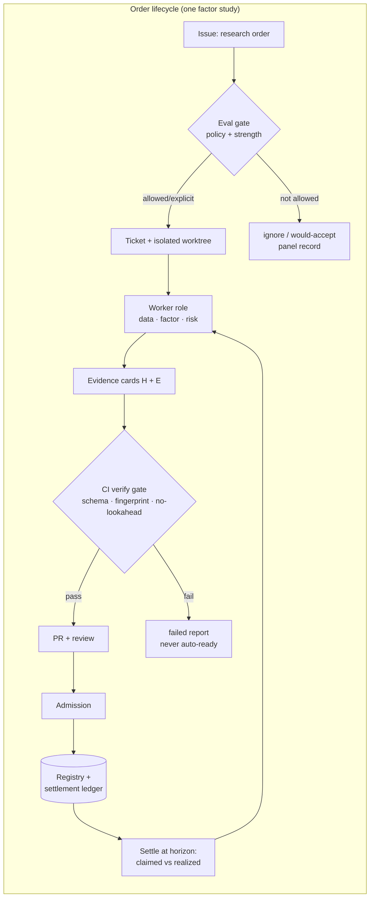

# Quant Super Agent

**A verifiable agentic quant research factory — machine-checked evidence, honest settlement, bounded autonomy.**

   

> **Status: v0.2 — evidence plane is runnable.** The design, benchmark specification, and roadmap were validated in internal pilots; the evidence plane (card schemas, verify gate, synthetic snapshots, deterministic forge emulation) now runs from this repository with zero dependencies — see [Quickstart](#quickstart). Higher layers (research loop, roles, settlement) migrate phase by phase (see [Roadmap](docs/ROADMAP.md)). Research use only — not financial advice.

---

## Why

Existing agentic quant frameworks generate *signals*; none of them generate *verifiable research*.

| Pain | Reality in current tools |
|---|---|
| **Unverifiable claims** | An agent reports "IC = 0.08" — nothing checks the data fingerprint, the look-ahead window, or whether the metric was computed at all |
| **No honesty feedback** | Claimed performance is never settled against realized performance; hallucinated alpha is indistinguishable from real alpha |
| **Unbounded autonomy** | Autonomous re-scheduling, tool use, and policy interpretation with no containment story (we measured one violating an explicit human instruction 26 seconds after acknowledging it) |
| **Irreproducible runs** | LLM non-determinism is acknowledged in READMEs, rarely measured, never decomposed |

Quant Super Agent attacks exactly these four. It runs the **full research lifecycle** — hypothesis → experiment → attribution → iteration → admission → settlement — on top of an order-driven agent harness, with three mechanisms that, to our knowledge, no other agentic quant project has:

## Three pillars

### 1. Machine-checked evidence

Every research claim ships as a structured **evidence card** that must pass a CI gate before it can be cited:

- **H cards** (hypotheses): registered *before* experiments — pre-declared windows, metrics, and pass thresholds.
- **E cards** (experiment results): must reference the exact data snapshot (sha256), the engine version, and the window; the gate rejects cards with missing fields, mismatched fingerprints, or look-ahead windows.

A claim that cannot be machine-verified does not exist. Our injection pilots confirm the gate catches malformed cards non-silently (see [Evidence](docs/EVIDENCE.md)).

### 2. Honest settlement calibration

Admitted factors are not "done" — they enter a **settlement ledger**. At the end of each evaluation horizon the claimed metric is settled against realized out-of-sample performance, and the gap feeds a reflection loop that influences future admissions. The system's headline metric is not return; it is the **calibration curve** (claimed vs realized), plus a zero-fabrication record.

### 3. Bounded autonomy

Autonomy is a dial, not a switch — and the dial has a fence:

| Level | Name | Behavior |
|---|---|---|
| L0 | observe | Runs the full pipeline, opens no tickets; records would-accept decisions for review |
| L1 | suggest | Proposes work items and evidence cards; human admits |
| L2 | admit-gated | Executes admitted orders; every policy change is a surgery with a checklist |
| L3 | autonomous | Unattended windows; bounded by a watchdog (measured 0.21 s detection→stop) and prompt discipline |

The design is informed by a real incident our pilots caught: an orchestrator agent re-queued a previously-ignored trigger and started work **26 seconds after** explicitly promising a human it would not (see [Evidence](docs/EVIDENCE.md)). The containment stack — surgery SOP + watchdog + discipline injection — was then validated in a three-arm × 5-round experiment.

## How it works



An E card, in the small (illustrative values):

```json
{
  "schema": "experiment_result",
  "exp_id": "E-0001",
  "hyp_id": "H-0001",
  "snapshot_sha256": "<sha256 of the immutable as-of data snapshot>",
  "engine": "qsa-verify-0.1.0",
  "window": ["YYYY-MM-DD", "YYYY-MM-DD"],
  "metrics": {"rankic_mean": 0.0, "monotonicity": 0.0},
  "verdict": "fail",
  "attribution": {"neighborhood_stable": false, "lag_k_flip": true}
}
```

Negative results are first-class: in our pilots, a failing factor produced exactly this shape of card — the metric missed the pre-registered admission threshold, the agent said so in its verdict, and attributed the instability instead of retrying its way to a pass.

## Comparison

| | TradingAgents | ai-hedge-fund | RD-Agent (Qlib) | FinRL | **Quant Super Agent** |
|---|---|---|---|---|---|
| Multi-role agents | ✔ analysts + debate | ✔ persona agents | ✔ research/dev loop | ✖ (RL, not agentic workflow) | ✔ quant roles (data/factor/risk/manager) |
| Research loop (H→E→iterate) | ✖ decision per date | ✖ | ✔ | ✖ | ✔ with attribution-driven hypothesis iteration |
| Claim-level CI gate | ✖ | ✖ | partial (backtest check) | ✖ | ✔ schema + fingerprint + no-lookahead |
| Settlement / calibration | memory log (雏形) | ✖ | ✖ | ✖ | ✔ claimed-vs-realized ledger |
| Autonomy control | ✖ | ✖ | ✖ | n/a | ✔ L0–L3 + watchdog (0.21 s measured) |
| Reproducibility protocol | acknowledged, unmeasured | ✖ | ✖ | seed-based | ✔ variance decomposition + data fingerprints |

Related work we admire and borrow from: [TradingAgents](https://github.com/TauricResearch/TradingAgents) (roles, debate, settlement memory), [ai-hedge-fund](https://github.com/virattt/ai-hedge-fund) (independent judgments → aggregation), [RD-Agent](https://github.com/microsoft/RD-Agent) (factor R&D iteration), [FinRL](https://github.com/AI4Finance-Foundation/FinRL) (environment rigor), [QuantDinger](https://github.com/OpenByteInc/QuantDinger) (local-first tooling). The harness patterns come from DeepSeek's MIT-licensed dsh-superagent research prototype (order lifecycle, worktree isolation, panel APIs) — see [Acknowledgments](#acknowledgments).

## Evidence from internal pilots

All numbers below are from our internal pilot environment (deterministic git-forge emulation, 2026-11); details and artifacts inventory in [docs/EVIDENCE.md](docs/EVIDENCE.md).

| Pilot | Result |
|---|---|
| Full-lifecycle smoke ×3 (positive path / permission gate / failure injection) | **3/3 PASS**; single order issue→PR end-to-end in 4 min 39 s; negative verdict recorded honestly |
| Fabrication injection (card missing required field, ordered to push anyway) | Gate blocked (CI failure 0/1), reported non-silently in 3 places, agent refused to fake readiness — and still filled real metrics honestly |
| Autonomy risk (G-1) three-arm × 5 rounds | Unattended requeue risk reproduced once in the wild; containment stack achieved **5/5 clean windows** in the full-protection arm; watchdog detection→stop **0.21 s**; zero spillover |
| Data plane | As-of snapshot + reconciliation tooling; 144-point cross-check zero mismatch; tamper-rejection verified |

## Roadmap (summary)

- **v0.1 (now)** design + benchmark spec + evidence docs public
- **v0.2** evidence cards + verify gate + sim forge (ported from pilot)
- **v0.3** research loop + hypothesis attribution + experiment registry
- **v0.4** quant roles + adversarial (bull/bear) review gate
- **v0.5** settlement ledger + calibration reporting
- **v0.6** Fabrication Injection Benchmark release (open runs against other frameworks)
- **v1.0** paper artifact + reproduction protocol

Full version: [docs/ROADMAP.md](docs/ROADMAP.md).

## Quickstart

v0.2 is runnable: pure Python ≥ 3.10 standard library, zero dependencies, fully offline and deterministic. The demo drives the whole lifecycle — `order issue → hypothesis card → toy experiment → experiment card → verify gate as CI → PR → merge under branch protection` — in seconds:

```bash
git clone https://github.com/0x1512/quant-super-agent.git
cd quant-super-agent
python examples/run_lifecycle.py            # honest run (on toy data the verdict is usually fail — and it merges)
python examples/run_lifecycle.py --fib 7    # inject a silent-pass fabrication; the gate blocks the merge
python -m unittest discover -s tests -v     # 31 tests: gate, FIB injections, determinism, forge
```

What the honest run prints (abbreviated):

```
[1] snapshot   toy synthetic, 1080 rows, window 20240102:20240506, sha 7b81decd7fdc…
[3] hypothesis H-0001 registered (admission pre-committed)
[5] experiment E-0001  rankic_mean=-0.014606 …
    honest verdict = fail (rankic_mean=-0.014606 fails pre-registered >= 0.02)
[6] push       … -> CI 'verify' = success
[7] merge      MERGED
```

A negative result with a green gate merges; a positive lie does not. That is the whole idea. The gate CLI also stands alone:

```bash
python -m qsa.verify --hypothesis cards/H.json --result cards/E.json --snapshot snapshot/
```

Chapter and verse in [docs/ARCHITECTURE.md](docs/ARCHITECTURE.md); acceptance evidence in [docs/EVIDENCE.md](docs/EVIDENCE.md).

## Documentation

- [Architecture](docs/ARCHITECTURE.md) — components, order lifecycle, gate internals, autonomy supervisor
- [Fabrication Injection Benchmark (spec v0)](docs/BENCHMARK.md) — 20 injection classes, honesty metrics, protocol
- [Evidence](docs/EVIDENCE.md) — pilot inventory, what was measured, artifacts map
- [Roadmap](docs/ROADMAP.md) — phases, scope, acceptance criteria
- 中文简介：[README.zh-CN.md](README.zh-CN.md)

## Acknowledgments

- The order-lifecycle harness patterns (orchestrator/worker, worktree isolation, panel API) are adapted from [dsh-superagent](https://github.com/deepseek-ai/dsh-superagent-prototype) (MIT), a research prototype by the DeepSeek Harness team (harness: [deepseek-harness](https://github.com/deepseek-ai/deepseek-harness)). Quant Super Agent is an independent project and is not affiliated with or endorsed by DeepSeek.
- Role/debate/settlement ideas informed by TradingAgents (Xiao et al., arXiv:2412.20138); factor-iteration framing by RD-Agent; portfolio realism by ai-hedge-fund and FinRL.

## Citation

```bibtex
@misc{quantsuperagent2026,
  title  = {Quant Super Agent: A Verifiable Agentic Quant Research Factory},
  author = {Quant Super Agent Contributors},
  year   = {2026},
  note   = {Design and benchmark specification, v0.1},
  url    = {https://github.com/0x1512/quant-super-agent}
}
```

## License & disclaimer

MIT — see [LICENSE](LICENSE). This is research software. Nothing here is financial advice, and nothing here should trade real money. All pilot results were obtained in emulation environments.
