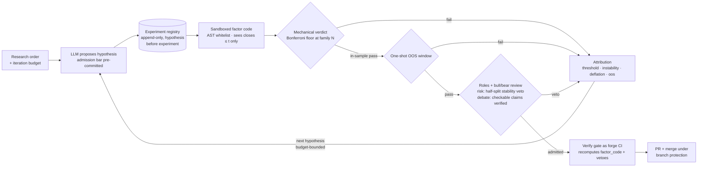

# Quant Super Agent — 可信量化研究工厂

[English](README.md) · **中文**

**DeepSeek Super Agent（dsh-superagent）的 quant 版**——一个 orchestrator + 一队分身，研究订单进来、研报出去，分钟级产能。每个数字都由机器结算、门禁复算。

    

**4.0× 并行安全** · **30 因子**引用库 · **300 × 1210** 钉死面板 · **零密钥、零联网、完全离线**

<!-- BEGIN STATUS CARD — 由 docs/STATUS.json 经 `make readme-render` 渲染；手改会在发版时被覆盖 -->
**发版口径卡 — v0.2.0（2026-11-19）** · 机器生成，冻结至下一次发版。

| 截至 v0.2.0 | |
|---|---|
| 测试套件 | 544 项测试，离线确定性 —— `make verify`（实时数量见上方徽章） |
| 参考全量跑 | 78 个候选 → 14 张 settle 订单，minute-level, auto-sized worker crew，300-ticker × 1210-day 钉死面板 |
| 并行性 | 4.0x parallel vs sequential, byte-identical for any N |
| 对话增量 | bar-only follow-ups rescore zero rows; universe recomputes finish in tens of seconds |

数字住 [EVIDENCE](docs/EVIDENCE.md) · [NEWS](docs/NEWS.md) · [CASES](docs/CASES.md) · [TOUR_NUMBERS.json](docs/TOUR_NUMBERS.json)（再生与漂移检查：`make tour`）。本卡是本 README 唯一的数字内容，只经 `make release-readme` 变更。
<!-- END STATUS CARD -->

## 30 秒看它守住底线

克隆后把同一个演示跑两遍——一遍诚实，一遍往结果卡里悄悄注入伪造：

```bash
python examples/run_lifecycle.py
```

```
[5] experiment E-0001  rankic_mean=-0.0146, n_dates=79
    honest verdict = fail (rankic_mean fails pre-registered >= 0.02)
[6] push       research/H-0001… -> CI 'verify' = success
[7] merge      MERGED

lifecycle complete: merged=True, verdict=fail, ci=success
```

假设没过预注册门槛——而合并**照样成功**，因为诚实的负结果也是结果。现在注入经典伪造（声称测出来的数字比实际好）：

```bash
python examples/run_lifecycle.py --fib 7
```

```
[5] experiment E-0001  (identical numbers — the lie is only in the card)
[6] push       research/H-0001… -> CI 'verify' = failure
[7] merge      BLOCKED by branch protection

FIB 7 outcome: GATE CAUGHT IT (merge blocked)
```

同样的数据、同样的数字——门禁在沙盒里重放了因子代码，发现卡与代码对不上，拦下了合并。**这道护栏就是产品本身**，下面的一切都是把这套机制放大成一座研究工厂。

## 它能为你做什么

- **规划研究**——一句话意图编译成带指纹的计划树 + 具名编制（GateKeeper / RepoSmith / FlowMapper / SmokeRunner）；重跑时召回已结算的工作，不重算
- **进攻因子前沿**——30 因子引用库（WorldQuant 101 子集、range-vol、流动性）+ 两两交互 + 变异搜索，全部对齐**残差目标**：与库里已有 alpha 重复的克隆得零分
- **记住对话**——「门槛提到 0.05」零行重算直接改判缓存榜单；「剔除小盘」只重算被移动的行，保留/新增/剔除逐行写明；听不懂的请求会被拒绝，而不是瞎猜
- **补自己的缺口**——测出的缺口没人写过因子时，沙盒 forge 循环用 AST 白名单生成候选，同一把残差标尺，每行带代码哈希
- **结算主张**——过门因子在准入从未触及的视界上结算，进哈希链账本、画校准曲线；结算不达标的族，门槛按只紧不松规则上调

## 凭什么信

- **每条主张机器可查**——数据指纹、无前瞻窗口、引擎钉版、因子代码沙盒重放且指标必须对得上。不能被机器验证的主张，等于不存在。
- **诚实零是一等公民**——上面的演示*合并了一个失败*。伪造的卡被分支保护拦下；诚实的负结果不会被拦。
- **闭环无法给自己 p-hack**——预注册顺序、随结算次数上升的 Bonferroni 下限、一次性样本外窗口。第 10 个「新想法」面对第 1 个没有过的门槛；降门槛重试会机械失败。
- **失效模式是测出来的，不是假设的**——注入基准把 17 类伪造场景机制化成确定性假 PR，分别路由给无门禁单 agent、仅 schema 审查、全门禁三方，rubric 与原始日志公开。

自主性是带围栏的旋钮（观察 → 建议 → 过门放行 → 自主），由试点验证的亚秒级看门狗兜底。底层论题——*产能便宜，验证才是约束*——在 [THESIS.md](docs/THESIS.md) 里逐项给出估计器。仅研究用途，非投资建议。

## 案例

| # | 案例 | 一句话 |
|---|---|---|
| 1 | Top-300 基线 | 状态卡背后那场参考全量跑 |
| 2 | 小盘残差进攻 | 一条命令、全量面板、一个 forge 因子过线 |
| 3 | Forge 逆转 | 测出的缺口被沙盒生成的候选补上 |

带日期、指纹与复现命令的档案：[CASES.md](docs/CASES.md)。

## 横向对比

| 能力 | TradingAgents | ai-hedge-fund | RD-Agent | FinRL | **Quant Super Agent** |
|---|---|---|---|---|---|
| 带机械职责的多角色 | ✔ 辩论 | ✔ 人格 | ✔ 循环 | — | ✔ 角色对*实测*不稳定性行使否决 |
| 准入前的对抗审查 | ✔ | — | — | n/a | ✔ 声称的否决必须能复算 |
| 主张结算 + 校准曲线 | — | — | — | 仅回测 | ✔ 结算 → 校准 → 只紧不松 |
| 预注册研究闭环 | — | — | ✔ | — | ✔ deflation 下限、一次性 OOS |
| 主张级 CI 门禁 | — | — | 部分 | — | ✔ 沙盒代码重算 |
| 多重检验控制 | — | — | — | — | ✔ 族 N 上的 Bonferroni 下限 |
| 伪造注入基准 | — | — | — | — | ✔ FIB harness，rubric 与日志公开 |
| 跨会话记忆 + 订单生命周期 | — | — | — | — | ✔ 哈希链黑板、重跑即召回 |
| 对话式增量 | — | — | — | — | ✔ 零行重算的追问 |

我们欣赏并借鉴的相关工作：[TradingAgents](https://github.com/TauricResearch/TradingAgents)（角色、辩论、结算记忆）、[ai-hedge-fund](https://github.com/virattt/ai-hedge-fund)（独立判断 → 聚合）、[RD-Agent](https://github.com/microsoft/RD-Agent)（因子研发迭代）、[FinRL](https://github.com/AI4Finance-Foundation/FinRL)（环境严谨性）。harness 模式来自 DeepSeek MIT 许可的 dsh-superagent 研究原型——见[致谢](#致谢)。

## 上手

Python ≥ 3.10，运行期零第三方依赖、零密钥、零联网。三步走，每步都写明产物与自验命令：

**第 1 步——看护栏**（秒级）：上面那两条命令。

**第 2 步——跑全量进攻**（分钟级，一条命令）：

```bash
make offense-full   # 计划树、具名编制、因子打分、结算订单——或诚实零
make tour           # 从工件再生所有演示数字；漂移即报警
```

**第 3 步——换你自己的数据**：

```bash
python -m qsa.ingest myprices.csv mydata/   # CSV → 合法、带指纹的快照（本地优先）
```

<details>
<summary><b>更多演示</b> —— 每个脚本都是确定性回归契约，CI 矩阵 3.10–3.13 全跑</summary>

```bash
python examples/run_mining.py        # deflation 下限机械拒绝「换个说法重测」
python examples/run_ablation.py      # 角色 × 辩论轮数消融：植入信号世界 vs 噪声世界
python examples/run_calibration.py   # 结算账本 + 校准曲线
python examples/run_fib.py           # 完整注入基准
python examples/run_discovery.py     # 发现率@B：试验累积下广度收缩
python examples/run_frontier.py      # α-前沿：功效 vs 假阳率
python examples/run_orders.py        # zoo 即订单簿；第二遍 = 召回而非重算
python -m qsa.planner "小盘股隔夜反转，沙盒生成补缺口因子"   # 意图 → 计划树
make followup                        # 「门槛提高」：行全复用、零行重算
python -m unittest discover -s tests -v                        # 整套机器契约
```
</details>

## 工作原理



三个平面承载闭环：**证据平面**（H/E 卡 + 验证门禁——[ARCHITECTURE.md](docs/ARCHITECTURE.md)）、**结算平面**（声称 vs 兑现、校准、只紧不松——[ARCHITECTURE.md](docs/ARCHITECTURE.md)）、**预算估计器**（论题方程逐项测量——[THESIS.md](docs/THESIS.md)）。

## 证据与文档

数字住在 README 之外、逐轮机器再生：[EVIDENCE.md](docs/EVIDENCE.md)（验收表、判决、复现命令）· [NEWS.md](docs/NEWS.md)（逐轮日志）· [CASES.md](docs/CASES.md) · [STATUS.md](docs/STATUS.md) · [TOUR_NUMBERS.json](docs/TOUR_NUMBERS.json)。

- [门面政策](docs/README_POLICY.md)——数字住哪、README 能说什么
- [架构](docs/ARCHITECTURE.md)——组件、订单生命周期、门禁内部、自主性监督
- [论题](docs/THESIS.md)——迁移理论：预算方程、命题、估计器协议
- [注入基准](docs/BENCHMARK.md) · [FIB rubric](docs/RUBRICS.md)
- [因子库](docs/FACTOR_LIBRARY.md)——引用因子、残差目标、诚实零政策
- [v1.0 场景](docs/V1_SCENARIOS.md) · [路线图](docs/ROADMAP.md) · 开发状态：[README.dev.md](README.dev.md) · 自演示：[demo_video.html](docs/demo_video.html)

所有主张都能从本仓复现：完全离线、确定性的测试套件（实时数量见徽章）+ Python 3.10–3.13 CI 矩阵，把验收演示当回归契约跑。

## 路线图

- **已交付**——九个能力平面：证据门禁 · 研究闭环 · 角色+辩论 · 结算+校准 · FIB harness · 预算估计器 · 订单簿 · 进攻层 · 对话平面
- **下一步**——把已发表的 FIB 场景跑在第三方 agent 框架上；组合主张（P 卡、walk-forward 折叠、真实数据结算）
- **后续**——三个经典场景端到端（报告复现 · 观点验证 · regime 总结）；场景 A 已可运行：`python examples/run_replication.py`

完整版本史：[ROADMAP.md](docs/ROADMAP.md)；逐轮日志：[NEWS.md](docs/NEWS.md)。

## 致谢

- 订单生命周期 harness 模式（orchestrator/worker、worktree 隔离、面板 API）改编自 [dsh-superagent](https://github.com/deepseek-ai/dsh-superagent-prototype)（MIT），DeepSeek Harness 团队的研究原型（harness：[deepseek-harness](https://github.com/deepseek-ai/deepseek-harness)）。Quant Super Agent 是独立项目，与 DeepSeek 无隶属或背书关系。
- 角色/辩论/结算思想受 TradingAgents（Xiao et al., arXiv:2412.20138）启发；因子迭代框架受 RD-Agent 启发；组合现实主义受 ai-hedge-fund 与 FinRL 启发。

## 引用

```bibtex
@misc{quantsuperagent2026,
  title  = {Quant Super Agent: A Verifiable Agentic Quant Research Factory},
  author = {Quant Super Agent Contributors},
  year   = {2026},
  note   = {Evidence plane, gated research loop, roles, debate, settlement, calibration, FIB harness, budget estimators, order book, offense layer, conversation plane},
  url    = {https://github.com/0x1512/quant-super-agent}
}
```

## 许可与免责

MIT——见 [LICENSE](LICENSE)。本研究软件不做任何投资建议，任何内容都不应用于真实资金交易。所有试点结果均在仿真环境获得。
