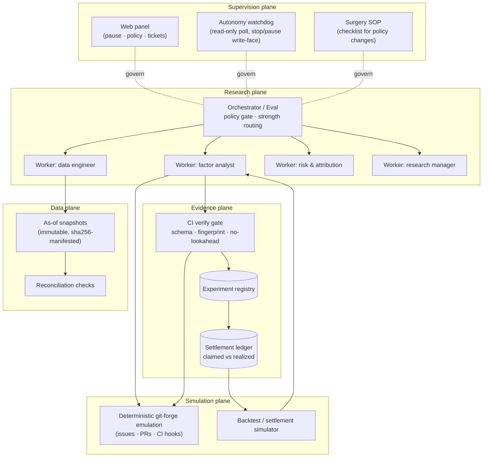

# Architecture (design; mechanism state as of v0.7)

Quant Super Agent runs the full quant research lifecycle as an **order-driven agent workflow**. This document describes the target architecture and how each component maps to mechanisms already validated in internal pilots (see [EVIDENCE.md](EVIDENCE.md)).

## System overview

## Order lifecycle

A factor study is an **order**. Each order walks:

1. **Issue** — a human (or a scheduled task) files a research order: scope, constraints, and — optionally — pre-registered hypothesis IDs. Orders without pre-registered H cards cannot produce citable E cards.
2. **Eval gate** — the orchestrator decides *strength* (explicit / inferred / follow-up) and checks *policy* (who may order what). Non-allowed triggers are ignored — and, in observe mode, recorded as **would-accept decisions** with full rule assessments, so the panel shows what the system *would* have done.
3. **Ticket + isolation** — accepted orders open a ticket and a worktree. Every worker session is isolated per order; cross-order contamination is structurally impossible (one order = one tree).
4. **Workers** — quant roles collaborate (see below).
5. **Evidence cards** — the deliverable is never prose; it is H/E cards (JSON, schema-versioned).
6. **CI verify gate** — a push hook runs the gate: schema completeness, snapshot fingerprint match, window alignment (no look-ahead), engine version pinning, and metric recomputation on a sampled basis. **A failing card can never be marked ready** — the agent must report failure as failure.
7. **Review & admission** — humans (L1/L2) or the manager (L3) admit or reject. Admission writes to the registry.
8. **Settlement** (shipped, v0.5) — at horizon end the world is deterministically continued from its seed, the factor re-executes in the sandbox, and realized performance is written to the hash-chained ledger against the claim. The calibration curve and a tighten-only reflection rule (family bar ×1.25 after repeated shortfalls) feed back into future admissions.

## Worker roles

| Role | Owns | Typical outputs |
|---|---|---|
| data engineer | snapshots, reconciliation, PIT discipline | manifests, recon reports |
| factor analyst | hypothesis → experiment | H cards, E cards, attribution |
| risk & attribution | robustness, kill criteria | neighborhood stability, capacity/turnover notes, veto cards |
| research manager | prioritization, admission proposals, iteration budget | next-hypothesis proposals, debate synthesis |

Roles are a **dial, not dogma**: the pilot ran a single generic worker successfully; v0.4 shipped the split as an ablation axis — measured, the risk duty and one debate round each remove a third of noise-world false positives at zero cost to discovery (see [EVIDENCE.md](EVIDENCE.md)).

## Autonomy supervisor

Three layers, validated in three-arm × 5-round pilots:

1. **Surgery SOP (L1)** — any policy change follows a six-step checklist: pause → change → verify → observe window → revert → resume. Mechanism analysis showed pause-first structurally removes the risk turn (notifications are injected without waking the agent; resume reads the reverted state).
2. **Watchdog (L2)** — an out-of-band process polls the panel API read-only; on rule triggers (e.g., a ticket whose mandate cites a surgery-window policy version) it stops the ticket. Measured detection→stop: **0.21 s**.
3. **Prompt discipline (L3)** — worker/orchestrator prompts carry requeue/policy-window discipline, applied and reverted as versioned settings with full audit trail.

Known platform gaps (no requeue permission surface; no configurable tool allowlist for main sessions) are documented and reported upstream; the supervisor exists precisely because the platform underneath does not provide these controls.

## Evidence card gate internals

The gate is intentionally dumb and strict — it checks, in order:

1. schema completeness (required fields, types)
2. `hyp_id` exists and was registered **before** the experiment window opened
3. `snapshot_sha256` matches the manifest of an immutable as-of snapshot
4. factor window ⊆ snapshot window; evaluation uses only data at or before each decision point (no look-ahead)
5. engine version pinned; with a ledger (`--registry`, v0.3): hypothesis-before-experiment ordering, family trial counts, one-shot OOS windows, and the deflated (multiple-testing-adjusted) verdict; when the card carries `factor_code`, the gate re-executes it in the AST-whitelist sandbox and requires the recomputed metrics to match — sampled recomputation becomes exhaustive
6. role duties and review (v0.4, shipped): the data role's feasibility pre-registration and the risk role's half-split stability veto are mechanical functions; a claimed risk veto must recompute from `factor_code` (a fabricated veto is a lie), an OOS block feeds the expected-verdict consistency check and its metrics are recomputed from source, and a review block must agree with the verifiable checks — a bear objection is upheld only if its check actually fails, bull rhetoric never admits
7. settlement ledger (v0.5, shipped): with `--settlement`, the ledger's hash chain must hold and every entry's realized metrics and outcome must recompute from the world spec + factor code it carries (FIB 19); an H card's `calibration` block must match the ledger-derived tighten-only reflection rule — dropping a justified tightening or claiming a rosier multiplier is a gate error
8. FIB harness (v0.6, extended v0.7): `qsa/fib.py` turns the injection classes of [BENCHMARK.md](BENCHMARK.md) into deterministic scenarios — honest card pairs with one scripted mutation each — and routes each submission through two baseline judges (`ungated`, `schema-only`) and this gate; catch rate, honesty, silent-pass, pressure asymmetry and localization are computed per judge ([RUBRICS.md](RUBRICS.md))
9. budget/cost plane (v0.7, shipped): the sandbox gains contract v2 (`closes, volumes, tickers, dates, i`) for liquidity-aware factors; the manifest may pin `costs.per_side_bps`; the engine computes coverage, turnover and net-of-cost spreads, and the gate recomputes them — a cherry universe dies on the pre-registered coverage bar (FIB 10) and a net-sold-at-gross card dies on cost recomputation (FIB 22). `qsa/budget.py` reads the budget-equation terms (ĪC, B, P̂, TC, decay slope) straight out of pipeline state; default worlds stay byte-frozen
10. verdict honesty: a `fail` with real metrics beats a fabricated `pass` — the gate cannot detect every fabrication, but the settlement ledger eventually can (see [BENCHMARK.md](BENCHMARK.md) for the adversarial side)

## Reproducibility

- The forge emulation is deterministic; data snapshots are immutable and fingerprinted.
- Variance decomposition protocol: run the same order K times; data plane and gate are expected to be zero-variance, model-path decisions are not. The protocol separates the two and reports per-stage variance (pilot infrastructure logs every event append-only to make this measurable).
